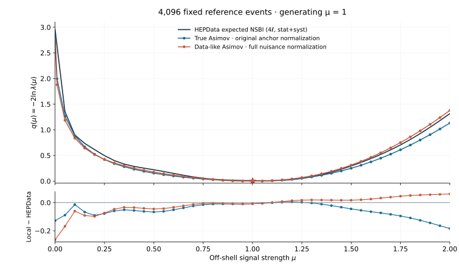
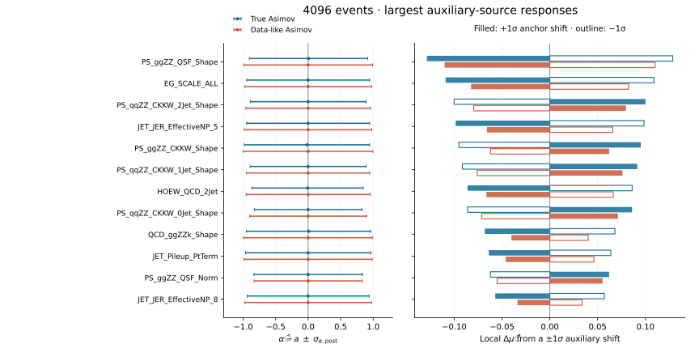

# True and data-like 4096 Asimov results

Both 42-point scans completed and passed independent likelihood validation.
The data-like construction recovers its generating signal strength while
shifting all 127 alpha and three cumulative qqZZ nuisance parameters to the
observed-data global-fit values. The generating signal strength remains mu=1.
The original true 4096 and 8192 workspaces are unchanged.

## Likelihood comparison

| Result | True 4096 | Data-like 4096 |
|---|---:|---:|
| Continuous mu_hat | 1.00144401 | 0.99999735 |
| q(0) | 2.82620244 | 2.69067207 |
| q(2) | 1.13193855 | 1.37754261 |
| RMS delta q, 41 shared coordinates [0,2] | 0.071811 | 0.062549 |
| RMS delta q, 30 shared coordinates [0.05,1.5] | 0.043756 | 0.048154 |

The reference is [HEPData Table 2, Exp NSBI, four-lepton stat+syst](https://doi.org/10.17182/hepdata.156805.v1/t2).
Compare exact coordinates with each continuous global minimum: no re-zeroing,
rescaling or reference interpolation. The 0.01 point has no matching published
coordinate. The data-like curve is closer in overall RMS over [0,2], especially
on the upper side; it is farther from HEPData at zero and slightly worse in RMS
on the earlier [0.05,1.5] range. Its largest absolute difference is 0.26333 at
zero; the true curve's is 0.18406 at mu=2. Neither is an exact reproduction.

The comparison includes **two changes**: shifted nuisance generation and full
interpolated same-reference normalization in the data-like model. The preserved
true model retains nominal/anchor normalization. It does not isolate the
nuisance shift alone. Supplied NumPy physics inputs also differ from the
observed-workspace template used for the original data validation.

All scan points have status 0 and EDM below 7.5e-6. Maximum independent
Delta-NLL discrepancies are 1.53e-10 (true) and 1.16e-10 (data-like).
Data-like SR integral closure is within 4.0e-15 throughout the scan.
Overlapping chunk points agree within 2.27e-5 and 1.77e-5 in q.
The merged extended true scan can choose the better converged overlapping
endpoint; the original 31-point and separate zero-point artifacts stay intact.

## Covariance source decomposition

The separate [method document](UNCERTAINTY_DECOMPOSITION.md) defines the
covariance-column probe, the source variances, and the conditional impacts.
Full Hesse succeeded for both samples with status 0, covariance quality 3
and positive-definite matrices. Required Migrad initialization refined the
saved points by at most 8.01e-5 in a parameter and 4.67e-8 in NLL; it does
not replace either scan baseline. All 131 parameters float.

| Local uncertainty component, sigma_mu | True 4096 | Data-like 4096 |
|---|---:|---:|
| Primary observations (SR + CRs) | 1.11244 | 0.99287 |
| Gaussian auxiliary observations | 0.37275 | 0.28474 |
| Quadrature source total | 1.17323 | 1.03290 |
| Observed-Hessian total | 1.15869 | 1.03201 |

The source sum exceeds the Hesse variance by 2.5265% (true) and 0.1722%
(data-like). No source component is rescaled. Four independent native-NLL
curvature checks differ from the Hesse prediction by at most 0.2945% and
0.2125%, respectively. Along the specific mu covariance probe, comparing
source covariance with native curvature leaves residuals of 2.3030% and
0.00551%. Thus the data-like source sum is consistent with the native
curvature to about 6e-5, while the preserved anchor-only model retains a
larger discrepancy. Generation/fit differences and the different model
normalizations remain relevant; this comparison does not isolate their effects.

The finite-difference source variances change by less than 8.1e-8 between
step-size estimates. A soluble Gaussian test checks source closure and the
distinction from freezing fitted nuisance coordinates. These are local
linear-response uncertainties, not confidence intervals from the non-parabolic
scan or the publication's Neyman belts.

The ranking shows the twelve largest auxiliary-observation responses across
the two models. Post-fit nuisance errors and pulls relative to each sample's
own auxiliary anchors appear alongside. All 130 nuisance diagnostics,
conditional impacts, explicit group assignments and both covariance matrices
are available in [the decomposition tables](../reports/data_like_4096/decomposition/).
The three unconstrained qqZZ factors contribute through the primary-data
response; their freeze/float penalty is reported separately, not as an
additional Gaussian source.

## Execution time and memory

The new data-like scan used five one-CPU Slurm chunks, taking 52m05s elapsed,
209.47 CPU minutes in total and at most 1.34 GiB RSS per job. Build/global
fits/checks took 35m00s elapsed and peaked at 4.76 GiB, including the rejected
initial covariance and repeated displaced-start fit. Final validation took
8m08s and peaked at 2.07 GiB. These stages ran on different CPU nodes.

The true upper extension took 31m35s elapsed across two chunks, 58.40 CPU
minutes and at most 1.18 GiB per job; its final validation took 4m31s.
Earlier true 4096/8192 costs remain in the original results report.

The separate covariance study, including setup failures and superseded
Jacobian diagnostics, took 36m21s / 37m02s elapsed, 39.74 / 40.59 CPU minutes,
and 1.21 / 1.78 GiB peak RSS for true/data-like, respectively. Full Hesse
itself took 1832.45 / 1857.92 seconds. All requested one CPU and 4 GiB.

A controlled same-CPU mu=.5 profile took 251.99 s (true) versus 304.10 s
(data-like), or 20.7% longer. Likelihood calls increased by 16.6%; time per
call by 3.5%. Alternating fixed-parameter NLL measurements found only 1.08%
extra cost for one-alpha changes, and 22.89% for all-alpha changes. See
[RooSameSampleNormalizer efficiency](ROO_SAME_SAMPLE_NORMALIZER.md#measured-evaluation-overhead)
and the [raw timing aggregate](../reports/data_like_4096/timing.json).

## Saved artifacts

- [Scan tables, parameters, comparison, checks and resource accounting](../reports/data_like_4096/).
- [Covariance matrices, source tables, impacts and closure diagnostics](../reports/data_like_4096/decomposition/).
- [Reveal.js branch](https://github.com/rafaellopesdesa/offshell_reweighting/tree/codex/asimov-results-slides-20261021).
- Local production workspace: `results/asimov_data_like_4096/data_like/workspace/HZZ_4l_data_like_asimov_4096.root`.
- Local full fits/logs: `results/asimov_data_like_4096/`; no event arrays or ROOT files are published.

The initial component-order prototype is explicitly rejected and preserved
outside the production path. The first stationary-start covariance was also
rejected; the saved profile baseline is the validated displaced-start result.
The original workspaces and observed-fit input retain their recorded SHA256s.
