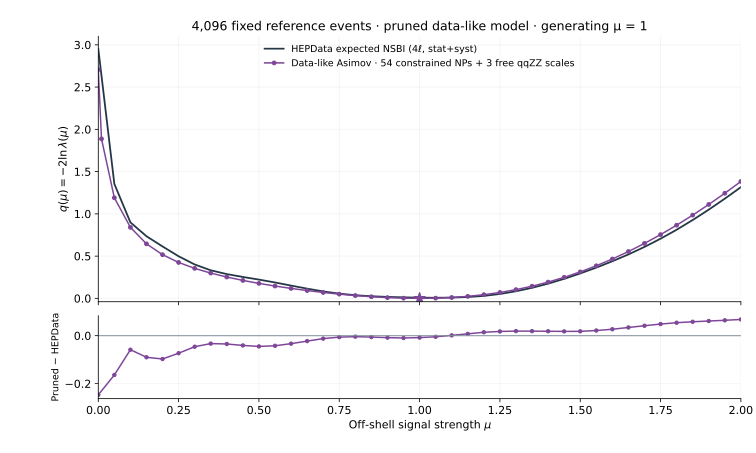
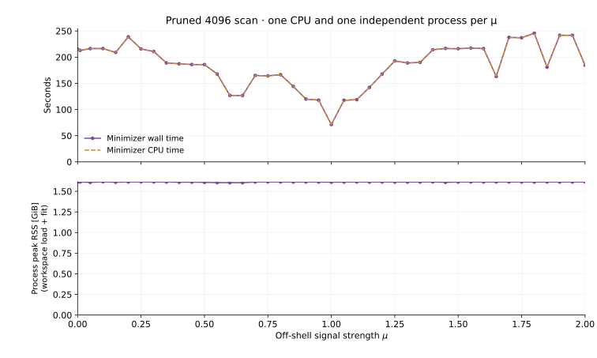

# Data-like 4096 Asimov with 54 constrained nuisance parameters

This study starts from the saved, fully normalized data-like 4096 workspace.
It retains the first 54 constrained entries in
[`all_np_uncertainty_ranking.csv`](../reports/data_like_4096/decomposition/all_np_uncertainty_ranking.csv),
in the published shared order: the larger absolute auxiliary response across
the true and data-like models. It does not re-rank the data-like model alone.
The three cumulative qqZZ normalizations remain free.

## Exact restriction of the existing model

For retained coordinates `alpha_keep` and removed coordinates `alpha_fixed`,
the new model is the original likelihood evaluated at

```text
L_pruned(mu, alpha_keep, beta) = L_full(mu, alpha_keep, alpha_fixed = alpha_generated, beta)
```

An irrelevant constant from fixed Gaussian constraints can change the absolute
NLL. Likelihood differences and profile test statistics use their own fitted
continuous baseline. The reference curves are never shifted or rescaled.

The 73 excluded alphas are fixed at their observed-fit generating values,
not reset to zero. Their shape/rate factors remain in the RooFit graph, and
their values remain in the generation snapshot. They are constant variables,
not free nuisance parameters; they are removed from the ModelConfig nuisance
set and their auxiliary observations from its global-observable set. The
retained 54 alphas have their original bounds and Gaussian constraints.

The template's parameter-of-interest grouping remains `mu`, `mu_qqZZ`,
`mu_qqZZ_1`, `mu_qqZZ_2`. Only `mu` is fixed during a profile, so 57 nuisance
coordinates are profiled; 58 parameters float in the global fit. The qqZZ
coefficients retain the cumulative products beta0, beta0*beta1 and
beta0*beta1*beta2.

The signal-region and all three control-region datasets are byte-identical
in a canonical export to the parent data-like dataset. The generating mu=1,
reference sample, reference weights, process normalizers, physical yields and
all nuisance interpolation functions are preserved. Fixed factors remain in
the graph and normalizer caches; memory usage is measured rather than inferred
from the number of floating parameters.

The new workspace is saved separately under
`results/asimov_data_like_4096_pruned54/workspace/` as
`HZZ_4l_data_like_asimov_4096_pruned54.root`. The true 4096 and unpruned
data-like 4096 workspaces remain at their original paths. A checksummed
`workspace_family.json` in the new run directory lists all three. The true
8192 workspace is also protected and unchanged.

## Fit and validation

`prune_data_like_asimov.py` reads the original workspace in read-only mode,
sets the restriction in memory and writes a separate file. The exact ranked
selection, fixed values, parent checksum and dataset digests accompany it.
`validate_pruned_asimov.py` reloads that file and checks its floating set,
snapshot, globals, all dataset columns and all 58 generating-point scores.
It compares process shapes, physical rates, CR expectations and NLL differences
with the original model at six settings, including mu=0 and mu=2 and
simultaneous retained-nuisance shifts. Same-reference normalization and the
normalizer's independent direct evaluation are checked at each setting.

The global fit starts at mu=1.4 with the original Minuit2 strategy-0 settings
and eps=0.0001. Saved ROOT/JSON agreement, positive-definite MIGRAD covariance
of quality 3, and recovery of generating parameters/NLL are required before
the scans run. This study does not compute another full Hesse matrix.

The scan evaluates 42 points: 0, 0.01, and 0.05 through 2 in steps of 0.05.
Every point starts independently from the saved global fit, fixes only mu,
and profiles the 57 nuisance coordinates. The existing fallback to strategy 1
is retained. Native extended-likelihood differences, saved point values,
positive event intensities and SR integral closure are checked independently
after merging. An additional check requires the restricted profile not to
fall below the unpruned profile beyond numerical tolerance.

## HEPData comparison and resources

The figure contains just the pruned profile and the unmodified
[HEPData Table 2 Exp NSBI four-lepton stat+syst curve](https://doi.org/10.17182/hepdata.156805.v1/t2).
Residual statistics use the 41 identical coordinates in [0,2]; mu=0.01 has
no published match and is excluded from those statistics.

Each coordinate runs as a fresh one-CPU Slurm array task, with at most six
tasks concurrent. This gives attributable per-mu peak memory measurements.
The table distinguishes minimizer wall/CPU time from whole-job Slurm time;
the process high-water RSS includes workspace loading and fitting. Slurm's
sampled MaxRSS is also retained. Stage elapsed time spans first start to
last finish, CPU time sums its jobs and peak RSS is the largest individual
job peak. Requested memory is recorded separately from measured memory.

Earlier unpruned scans used warm-start chunks and different cluster nodes.
Their runtime difference from this independent-start scan is not a controlled
measurement of the speedup from pruning. The report includes the canceled
checksum-helper prototype separately; no fit had started when it was replaced.
Original and revised source snapshots, logs and outputs are preserved.

`kept_nuisances.csv` copies the selection and original unpruned ranking
diagnostics; it is not a newly computed covariance decomposition.

The standalone report script `report_pruned_asimov.py` exports the likelihood
comparison, per-mu cost figure, full tables, convergence diagnostics, source
checksums and Slurm accounting from completed validated outputs.

## Completed results

All 42 profile points passed convergence and independent likelihood checks.
The source workspaces and their saved fit baselines remain unchanged.



| Quantity | Pruned data-like 4096 |
|---|---:|
| Global mu_hat | 1.0000274369 |
| Global EDM | 1.37e-08 |
| q(0) | 2.70714139 |
| q(2) | 1.38365433 |
| RMS delta q vs HEPData, 41 shared points | 0.061185 |
| Maximum absolute delta q vs HEPData | 0.246859 |
| Maximum independent profile delta-NLL disagreement | 1.56e-10 |
| Maximum SR integral mismatch | 3.33e-15 |

The largest HEPData residual is at mu=0. The pruned-minus-unpruned q differences range from 9.8662e-09 to 0.0164693; the lower endpoint is within minimization precision. No values are clipped or rescaled.

The displaced-start global minimization took **286.44 seconds**, 1,410 likelihood calls and **1.614 GiB** process peak RSS through the fit. Stage accounting below also includes the recovery check.

| Stage | Jobs | Elapsed | Total CPU minutes | Largest job peak RSS |
|---|---:|---:|---:|---:|
| Superseded setup/check | 1 | 3m57s | 3.59 | 3.668 GiB |
| Build and construction checks | 1 | 3m23s | 3.35 | 3.105 GiB |
| Global fit and recovery check | 1 | 5m21s | 5.29 | 1.757 GiB |
| 42 independent profiles | 42 | 26m37s | 139.26 | 1.718 GiB |
| Merge and likelihood checks | 1 | 9m26s | 9.38 | 2.044 GiB |



Per-point minimizer wall time is 71.34–245.75 seconds (median 188.91); process peak RSS is 1.604–1.614 GiB. These are single measurements on different nodes, not a controlled before/after speed benchmark.

Download the [per-mu scan and resource table](../reports/pruned_data_like_4096/profile_resources.csv),
[stage accounting](../reports/pruned_data_like_4096/resources.csv),
[all job measurements](../reports/pruned_data_like_4096/job_resources.csv),
[validation table](../reports/pruned_data_like_4096/scan_validation.csv), and
[complete numerical summary](../reports/pruned_data_like_4096/summary.json).
Standalone figures are available as SVG, PNG and PDF in the same directory.
